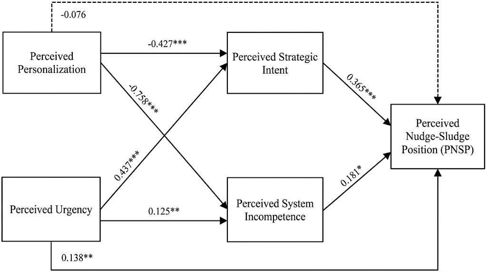
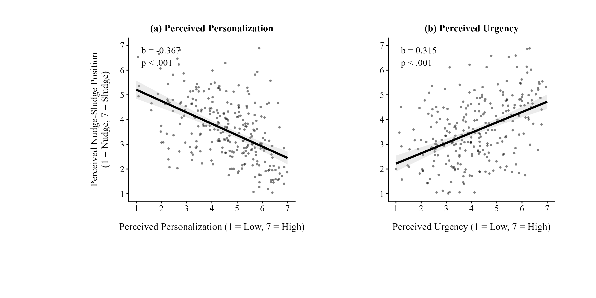

# When Relevance Meets Urgency in Recommendation Agents: How Choice Personalization and Delivery Framing Shape User Perceptions on the Nudge-Sludge Continuum

MSc Business Information Management thesis · Rotterdam School of Management, Erasmus University · June 2026

## Abstract

> As recommendation agents evolve into personalized choice architects, they increasingly risk both supporting and undermining user autonomy. In the context of personalized recommendation agents, this study investigates how choice personalization and urgency-based delivery framing intensity shape users' evaluations of a recommendation's position on the nudge-sludge continuum (Thaler et al., 2013; Thaler, 2018) moderated by their pre-disposed privacy concerns, building on Mills's (2022) dual-personalization framework. The 278 participants in a between-subjects 2 × 2 online experiment interacted with a simulated personalized movie streaming platform. Due to the choice personalization manipulation not producing significant difference among its two conditions, confirmatory hypothesis testing could not produce statistically significant results. Exploratory analyses using continuous perceptual measures revealed that perceived personalization and urgency are each significantly associated with sludge perception in opposing directions, operating as distinct but correlated perceptual pathways, with strategic intent attribution being the main driver alongside perceived system incompetence. Privacy concerns emerged as a dispositional baseline associated with higher sludge perception independently of interface features. The contribution of this study is empirical evidence that attributional reasoning may be more central to sludge evaluation than objective design characteristics, and the proposal of a reconceptualization of the nudge-sludge continuum as a perceptual and attributional construct.

## At a glance

- **Question:** when does a personalized recommendation feel like a helpful *nudge*, and when does it feel like pressure, or *sludge*?
- **Method:** an online experiment (N = 278, recruited via Prolific) on a movie-streaming prototype I built, varying how well the recommendation matched the user and how urgently it was framed, analysed in R.
- **Answer:** how users judge a recommendation depends less on what the system objectively did than on *why they think it did it*. Perceived intent to steer them was the strongest driver of sludge perception.

## Study design

Each participant saw one "Top Pick" recommendation. Two factors were varied:

| | Low personalization (Top Pick mismatched to the user's genre) | High personalization (matched) |
|---|---|---|
| **Moderate urgency** (neutral "leaves in 24 hours" note) | Cell 1 (n = 68) | Cell 2 (n = 69) |
| **Excessive urgency** (countdown timer, red banner, "ACT FAST") | Cell 3 (n = 65) | Cell 4 (n = 76) |

How the recommendations were generated for each condition is described in [`docs/recommendation-logic.md`](docs/recommendation-logic.md).

### Try the prototype

**[Open the StreamVibe prototype](https://thesis-experiment.lovable.app/)** is the interface participants used. Pick up to three genres and you'll get a "Top Pick". The condition is randomised on each visit. To see a specific one, add a parameter to the URL:

| URL ending | Condition |
|---|---|
| `?cell=1` | Moderate urgency, low personalization |
| `?cell=2` | Moderate urgency, high personalization |
| `?cell=3` | Excessive urgency, low personalization |
| `?cell=4` | Excessive urgency, high personalization |

StreamVibe is a fictional platform built only as a research stimulus, and data collection is finished. Film titles, artwork and ratings shown in it belong to their respective rights holders.

## Key findings

**Manipulation checks.** The urgency manipulation was successful: participants in the excessive urgency condition reported significantly higher perceived time pressure (M = 4.62, SD = 1.41) than those in the moderate urgency condition (M = 3.76, SD = 1.33), t(276) = −5.28, p < .001, d = −0.63. The choice personalization manipulation, however, did not reach statistical significance (p = .173, d = −0.17), indicating that the original design did not induce distinct perceptions of relevance between its two conditions.

**Confirmatory hypothesis testing.** Hypotheses 1 to 3 were not supported. In the three-step hierarchical regression, the urgency condition did not significantly predict perceived nudge-sludge position (PNSP; b = 0.186, p = .220), and neither the two-way nor the three-way interaction added significant explained variance. Privacy concerns were the sole significant predictor (b = 0.167, p = .027). Because the personalization manipulation failed, H2 and H3 could not be adequately tested.

**Exploratory analyses.** Given the failed manipulation, supplementary analyses used participants' continuous perceptions instead of their assigned conditions. This model explained considerably more variance in PNSP (R² = .371) than the categorical model (R² = .025). Perceived personalization and perceived urgency were each significantly associated with sludge perception, in opposing directions, and the two were themselves negatively correlated, operating as distinct but correlated perceptual pathways.

| Predictor of PNSP (continuous perceptual model) | b | p |
|---|---|---|
| Perceived personalization | −0.367 | < .001 |
| Perceived urgency | 0.315 | < .001 |
| Privacy concerns | 0.052 | n.s. |

**Attributional pathways.** Perceived strategic intent was approximately twice as strong a predictor of PNSP (b = 0.424, p < .001) as perceived system incompetence (b = 0.248, p < .001), and together they explained 52.3% of its variance. In the parallel mediation model (CFI = .945, SRMR = .050), strategic intent emerged as the dominant mediating pathway. For perceived urgency, the indirect effect through strategic intent (b = 0.159, 95% CI [0.107, 0.238]) was considerably stronger than that through system incompetence (b = 0.023, 95% CI [0.005, 0.051]), alongside a significant direct effect (partial mediation). The direct effect of perceived personalization was non-significant (b = −0.076, p = .241), consistent with full mediation.





**Privacy concerns.** Participants with high privacy concerns (median split) reported significantly higher PNSP (M = 3.71, SD = 1.33) than those with low privacy concerns (M = 3.37, SD = 1.17), t(276) = 2.22, p = .027, d = 0.27, suggesting that privacy concerns operate as a dispositional baseline associated with higher sludge perception independently of interface features.

**Interpretation.** The findings provide empirical evidence that attributional reasoning may be more central to sludge evaluation than objective design characteristics. As the categorical personalization manipulation failed, all findings beyond the manipulation checks and confirmatory tests should be treated as exploratory rather than confirmatory, and the direction of effects cannot be interpreted with the same confidence as those of a successful experimental manipulation.

## So what for a product team?

These are directional implications from exploratory data, not proven interventions.

1. **Unjustified urgency costs trust.** Urgency cues raised sludge perception both directly and by signalling intent. Tie them to a real, verifiable constraint (a title really leaving the catalogue), or tone them down.
2. **Perceived relevance matters as much as model accuracy.** Showing users *why* something was recommended may do more for how it feels than a marginally better algorithm. I did not test which explanation works.
3. **For privacy-sensitive users, trust is built before the recommendation.** Clear data-use disclosures and user-controlled personalization settings address the problem earlier than interface tweaks.

## What I'd do differently

- **Pilot the manipulation first.** Personalization was operationalized as a binary matched/mismatched Top Pick, which was too weak. A fully mismatched recommendation or a continuous perceived-relevance design would have been testable.
- **Measure attributions before the outcome**, to separate cause from effect. All measures were taken at one point in time.
- **Recruit a more balanced sample.** The sample was 60% male, 72% under 35, heavy streamers and privacy-conscious, which limits generalisation.
- **Replicate beyond streaming.** Urgency is easy to justify for a film "leaving the library", but harder in e-commerce or finance.

## Skills this project shows

- **Experiment design:** a 2 × 2 between-subjects study, a power analysis (264 needed, 278 analysed), pre-specified hypotheses and manipulation checks.
- **Instrument design:** a new 9-item sludge-perception scale that I developed and then validated and trimmed to 7 items (α = .87).
- **Data quality:** attention checks, speeding and straight-lining screens, and a common-method-bias test.
- **Statistics in R:** hierarchical regression, EFA and reliability, bootstrapped path models in `lavaan`, and robust standard errors.
- **Honest reporting:** a failed manipulation reported as such, exploratory results kept separate from confirmatory ones, and limitations stated.
- **Prototyping:** a high-fidelity interactive prototype (Figma, Lovable) with rule-based recommendation logic on the MovieLens 25M dataset.

## What's in this repo

```
analysis/analysis.R                full analysis (R 4.5.3), sections match thesis chapter 4
analysis/recommendation_mapping.R  how the prototype's recommendations were generated
mapping/                           the 129-combination lookup tables (film titles only)
docs/methodology.md                design, stimuli, measures, sample, analysis plan, limitations
docs/recommendation-logic.md       scoring, clusters, tiers and overrides behind each recommendation
docs/codebook.md                   variables, scales, scoring and exclusion rules
figures/                           mediation model, perceived-effects plot
data/README.md                     why the data is not included, and how to re-run with your own
```

**Not included:** raw data (participant anonymity), the prototype's source code and film artwork (third-party material), and the full thesis PDF.

## Reproducing the analysis

The raw data is not published, so `analysis.R` will not run as-is. If you run a similar study, export from Qualtrics with the same structure (see `docs/codebook.md`), save it as `data/qualtrics_export.csv`, and run the script from the repository root. The recommendation lookup tables can be regenerated with `analysis/recommendation_mapping.R` from the public [MovieLens 25M dataset](https://grouplens.org/datasets/movielens/25m/) (not included). Packages for `analysis.R`: `tidyverse`, `psych`, `car`, `effectsize`, `performance`, `careless`, `mediation`, `patchwork`, `lavaan`, `see`, `lmtest`, `sandwich`.

## Contact

Natalia Poulakida · [TODO: LinkedIn] · [TODO: email]

## Licence

Code: MIT (see `LICENSE`). Text and figures: © Natalia Poulakida; please cite if you reuse them.
